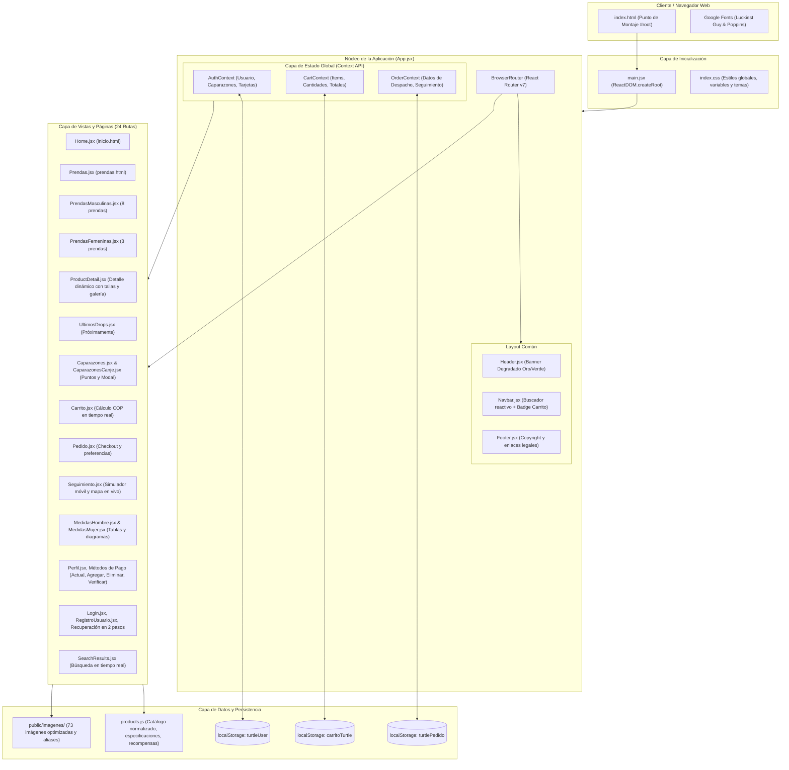
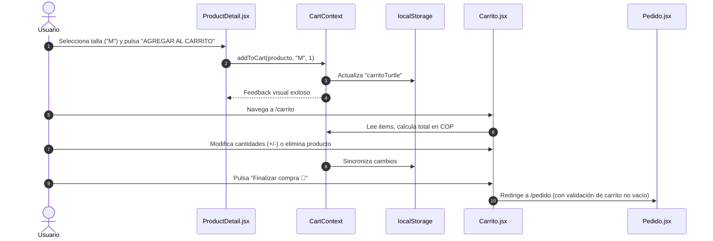
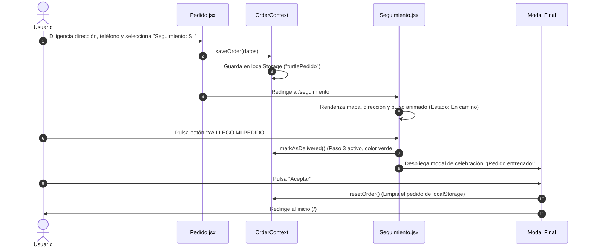
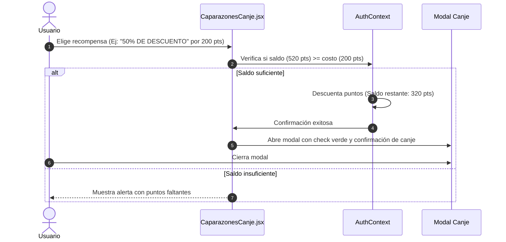

# TURTLE INC — Aplicación Web en React

Migración integral y profesional del sitio web original contenido en `html-referencia` hacia una arquitectura moderna, reactiva y orientada a componentes utilizando **React 19**, **Vite** y **React Router**.

---

## 🏛️ Arquitectura del Sistema Frontend

La aplicación fue diseñada siguiendo los principios de arquitectura de software frontend para Single Page Applications (SPA), con separación de responsabilidades en capas desacopladas, flujo unidireccional de datos y una única fuente de la verdad (*Single Source of Truth*).

### Diagrama General de Arquitectura



---

## 🧩 Capas de la Arquitectura

### 1. Capa de Presentación e Interfaz (UI/UX)
* **Diseño e Identidad Fiel**: Se preservó la estética original con el degradado insignia `linear-gradient(90deg, #FFD700, #81C784)`, bordes redondeados, botones de interacción rápida con animaciones suaves y tipografía dual: `'Luckiest Guy'` para títulos e identidad visual y `'Poppins'` para legibilidad de textos largos y formularios.
* **Componentes Atómicos y Estructurales**:
  - `Header`: Cabecera responsiva con título dinámico configurable por página.
  - `Navbar`: Menú interactivo con enlaces activos, campo de búsqueda integrado con botón tortuga (`🐢`) y contador dinámico de prendas añadidas en el carrito.
  - `Footer`: Pie de página unificado para consistencia en todas las vistas.
* **Modales y Diálogos Interactivos**: Modales reutilizables con animación CSS `aparecer` y `backdrop-filter: blur(5px)` para canje de puntos de recompensas, confirmación de pedidos sin seguimiento y celebración de entrega de paquetes.

### 2. Capa de Estado Global (Context API)
Se implementaron 3 contextos reactivos independientes para evitar el *prop drilling* y garantizar consistencia en toda la aplicación:

* **`CartContext` (`src/context/CartContext.jsx`)**:
  - Administra los productos seleccionados, tallas, subtotales y cantidades.
  - Formateo de moneda colombiana (`$199.000 COP`).
  - Sincronización bidireccional inmediata con `localStorage` bajo la clave `carritoTurtle`.
  - Validación de carritos vacíos antes de permitir el checkout.

* **`OrderContext` (`src/context/OrderContext.jsx`)**:
  - Almacena dirección física, teléfono, notas del pedido, canal de aviso preferido (SMS o llamada) y activación de rastreo.
  - Máquina de estados para el rastreo del pedido: `Paso 1: Confirmado` ➔ `Paso 2: En camino` ➔ `Paso 3: Entregado`.
  - Sincronización con `localStorage` bajo la clave `turtlePedido`.

* **`AuthContext` (`src/context/AuthContext.jsx`)**:
  - Gestiona los datos del cliente, billetera de puntos **Caparazones** (saldo inicial de 520 pts) y métodos de pago registrados.
  - Operaciones CRUD seguras para tarjetas: ver actual, agregar nueva, verificar mediante código y eliminar con advertencia de irreversibilidad.

### 3. Capa de Datos y Dominio (`src/data/products.js`)
* Centraliza el catálogo en una estructura inmutable con:
  - **16 prendas principales** (8 masculinas y 8 femeninas).
  - **4 artículos de "Últimos Drops"** con insignias `PRÓXIMAMENTE`.
  - **4 niveles de recompensa** del programa Caparazones (25%, 50%, 75% y 99% de descuento).
  - Cada producto contiene: `id`, `slug`, `name`, `displayName`, `category`, `price`, `itemCode`, `images`, `sizes`, `description`, `specs`, `care` y `modelNote`.

### 4. Capa de Persistencia y Caché Local
Los datos del usuario, el pedido y el carrito sobreviven a recargas del navegador mediante adaptadores transparentes en `localStorage`:
- `carritoTurtle`: Lista de items, cantidades y total acumulado.
- `turtlePedido`: Datos del domicilio y progreso de entrega.
- `turtleUser`: Perfil, saldo de puntos y tarjetas asociadas.

### 5. Capa de Enrutamiento y Compatibilidad Retroactiva
El enrutador (`src/App.jsx`) implementa rutas semánticas limpias y proporciona **redirecciones automáticas para todos los 38 archivos `.html` originales**. Si un usuario o enlace externo accede a `/carritotortugo.html` o `/camisaprueba1.html`, es redirigido de forma instantánea a su ruta React correspondiente (`/carrito` o `/producto/camisaprueba1`).

---

## 🗺️ Matriz de Mapeo: `html-referencia` vs. React

| Archivo Original en `html-referencia/HTML/` | Componente React | Ruta SPA | Responsabilidad y Lógica |
|---|---|---|---|
| `inicio.html` | `Home.jsx` | `/` | Portada institucional, propuesta de valor y botones de acción |
| `prendas.html` | `Prendas.jsx` | `/prendas` | Selector de colección con tarjetas fotográficas de hombre y mujer |
| `prendasmasculinas.html` | `PrendasMasculinas.jsx` | `/prendas/masculinas` | Catálogo de las 8 prendas masculinas con precios en COP |
| `prendasfemeninas.html` | `PrendasFemeninas.jsx` | `/prendas/femeninas` | Catálogo de las 8 prendas femeninas con precios en COP |
| `camisaprueba1.html` | `ProductDetail.jsx` | `/producto/camisaprueba1` | Vista detallada: Camisa Hombre Turtle Inc ($199.000) |
| `buzohombre.html` | `ProductDetail.jsx` | `/producto/buzohombre` | Vista detallada: Buzo Verde Turtle Inc ($259.000) |
| `zapatoshombre.html` | `ProductDetail.jsx` | `/producto/zapatoshombre` | Vista detallada: Zapatos Urbanos Turtle Inc ($299.000) |
| `conjuntohombrebuzoysudadera.html` | `ProductDetail.jsx` | `/producto/conjuntohombrebuzoysudadera` | Vista detallada: Conjunto con sudadera ($379.000) |
| `gorrablanca.html` | `ProductDetail.jsx` | `/producto/gorrablanca` | Vista detallada: Gorra Turtle Inc ($59.000) |
| `buzooscurohombre.html` | `ProductDetail.jsx` | `/producto/buzooscurohombre` | Vista detallada: Camisa Manga Larga ($210.000) |
| `gafashombre.html` | `ProductDetail.jsx` | `/producto/gafashombre` | Vista detallada: Gafas Aviador Turtle Inc ($499.000) |
| `pantalonetacasual.html` | `ProductDetail.jsx` | `/producto/pantalonetacasual` | Vista detallada: Pantaloneta Casual ($79.000) |
| `topmujerprueba.html` | `ProductDetail.jsx` | `/producto/topmujerprueba` | Vista detallada: Top Mujer Negro ($69.000) |
| `buzorosamujer.html` | `ProductDetail.jsx` | `/producto/buzorosamujer` | Vista detallada: Buzo Rosa Turtle Inc ($189.000) |
| `buzooversizemujer.html` | `ProductDetail.jsx` | `/producto/buzooversizemujer` | Vista detallada: Buzo Oversize Mujer ($199.000) |
| `joggermujer.html` | `ProductDetail.jsx` | `/producto/joggermujer` | Vista detallada: Jogger Urbano Mujer ($99.000) |
| `topblanco.html` | `ProductDetail.jsx` | `/producto/topblanco` | Vista detallada: Top Blanco Ajustado ($69.000) |
| `chaquetamujer.html` | `ProductDetail.jsx` | `/producto/chaquetamujer` | Vista detallada: Chaqueta Bomber Mujer ($219.000) |
| `faldamujer.html` | `ProductDetail.jsx` | `/producto/faldamujer` | Vista detallada: Falda Cargo Militar ($149.000) |
| `vestidodebaño.html` | `ProductDetail.jsx` | `/producto/vestidodebaño` | Vista detallada: Vestido de Baño ($199.000) |
| `ultimos-drops.html` | `UltimosDrops.jsx` | `/ultimos-drops` | Galería de 4 prendas y accesorios en preventa |
| `caparazones.html` | `Caparazones.jsx` | `/caparazones` | Información del sistema de puntos y consulta de saldo |
| `caparazones2.html` | `CaparazonesCanje.jsx` | `/caparazones/canjear` | Recompensas canjeables con modal reactivo de éxito |
| `carritotortugo.html` | `Carrito.jsx` | `/carrito` | Carrito reactivo con edición de cantidades y eliminación |
| `pedido.html` | `Pedido.jsx` | `/pedido` | Formulario de despacho con selección de seguimiento |
| `seguimiento.html` | `Seguimiento.jsx` | `/seguimiento` | Mockup móvil, mapa con ruta, pulso y botón de entrega |
| `medidashombre.html` | `MedidasHombre.jsx` | `/medidas/hombre` | Tabla de medidas corporales masculinas y diagrama |
| `medidasmujeres.html` | `MedidasMujer.jsx` | `/medidas/mujer` | Tabla de medidas corporales femeninas y diagrama |
| `perfil.html` | `Perfil.jsx` | `/perfil` | Perfil de usuario con avatar y accesos a métodos de pago |
| `metodo-actual.html` | `MetodoActual.jsx` | `/perfil/metodo-actual` | Consulta de tarjeta actual (Nequi) y estado de verificación |
| `ingresar-tarjeta.html` | `IngresarTarjeta.jsx` | `/perfil/ingresar-tarjeta` | Registro de tarjeta con validación y mensaje de éxito |
| `eliminar-metodo.html` | `EliminarMetodo.jsx` | `/perfil/eliminar-metodo` | Confirmación con advertencia de borrado irreversible |
| `verificar.html` | `VerificarMetodo.jsx` | `/perfil/verificar` | Input para código SMS de 6 dígitos con confirmación |
| `pago.html` | `PagoDirecto.jsx` | `/pago` | Pantalla de pago rápido de 2 columnas con confirmación |
| `registro.html` | `Login.jsx` | `/login` | Formulario de inicio de sesión con recordatorio |
| `registrousuario.html` | `RegistroUsuario.jsx` | `/registro-usuario` | Alta de nuevos usuarios con validación de contraseña |
| `olvidastecontraseña.html` | `OlvidastePassword.jsx` | `/olvidaste-password` | Envío de código de restablecimiento de contraseña |
| `nuevacontraseña.html` | `NuevaPassword.jsx` | `/nueva-password` | Creación de nueva contraseña y redirección |
| *(Novedad React)* | `SearchResults.jsx` | `/buscar?q=...` | Búsqueda global reactiva conectada al botón 🐢 del navbar |

---

## 🔄 Ciclos de Vida e Interacciones Clave

### 1. Flujo de Compra y Carrito


### 2. Flujo de Pedido, Despacho y Seguimiento en Vivo


### 3. Flujo del Programa de Recompensas ("Caparazones")


---

## ⚡ Optimizaciones para Producción y Compatibilidad

1. **Compilación Ultrarrápida con Vite 6**:
   - `vite build` genera un bundle altamente optimizado con *tree-shaking* automático.
   - Chunks finales: CSS (16.5 kB gzipped a 3.9 kB) y JS (336 kB gzipped a 100 kB).
2. **Resiliencia de Recursos Multimedia (Cross-Platform)**:
   - Los nombres de archivo con caracteres especiales en Windows (espacios, mayúsculas `.PNG` y acentos como `traje de baño.png`) disponen de copias con nombres normalizados en `public/imagenes/` para evitar errores `404` en servidores Linux/macOS case-sensitive (como Vercel, Netlify o AWS S3).
3. **Persistencia Reactiva**:
   - Sin dependencias externas pesadas de almacenamiento: se utiliza la API nativa de `localStorage` mediante hooks y serialización JSON segura.
4. **Enrutamiento SPA con Cero Refresco**:
   - Transiciones instantáneas entre páginas mediante `Link` y `useNavigate` de `react-router-dom`, sin recargas de página completas.

---

## 📁 Árbol de Archivos del Proyecto React

```text
munera-proyecto-react/
├── .gitignore               # Exclusión de node_modules, dist y logs
├── index.html               # Entry HTML con prefetch de fuentes de Google
├── package.json             # Scripts y dependencias oficiales (React 19, Vite 6, Router v7)
├── vite.config.js           # Configuración de Vite con plugin React
├── README.md                # Documentación técnica completa y arquitectura
├── html-referencia/         # Código fuente original (HTML/CSS/JS) usado de referencia
├── public/
│   └── imagenes/            # 73 imágenes fotográficas y tablas de medidas
└── src/
    ├── main.jsx             # Punto de montaje ReactDOM
    ├── App.jsx              # Enrutador principal y configuración de Providers
    ├── index.css            # Hoja de estilos global consolidada
    ├── components/          # Componentes reutilizables
    │   ├── Header.jsx       # Barra superior con degradado insignia
    │   ├── Navbar.jsx       # Barra de navegación con buscador y badge reactivo
    │   └── Footer.jsx       # Pie de página institucional
    ├── context/             # Gestión de estado global con Context API
    │   ├── AuthContext.jsx  # Sesión, puntos Caparazones y medios de pago
    │   ├── CartContext.jsx  # Carrito de compras, cantidades y totales
    │   └── OrderContext.jsx # Despacho y seguimiento en tiempo real
    ├── data/
    │   └── products.js      # Catálogo de 16 prendas, 4 drops y recompensas
    └── pages/               # 24 vistas migradas
        ├── Home.jsx
        ├── Prendas.jsx
        ├── PrendasMasculinas.jsx
        ├── PrendasFemeninas.jsx
        ├── ProductDetail.jsx
        ├── UltimosDrops.jsx
        ├── Caparazones.jsx
        ├── CaparazonesCanje.jsx
        ├── Carrito.jsx
        ├── Pedido.jsx
        ├── Seguimiento.jsx
        ├── MedidasHombre.jsx
        ├── MedidasMujer.jsx
        ├── Perfil.jsx
        ├── MetodoActual.jsx
        ├── IngresarTarjeta.jsx
        ├── EliminarMetodo.jsx
        ├── VerificarMetodo.jsx
        ├── PagoDirecto.jsx
        ├── Login.jsx
        ├── RegistroUsuario.jsx
        ├── OlvidastePassword.jsx
        ├── NuevaPassword.jsx
        └── SearchResults.jsx
```

---

## 🚀 Guía de Uso y Comandos

### Instalación de Dependencias
```bash
npm install
```

### Iniciar Servidor de Desarrollo
```bash
npm run dev
```
Abre la aplicación en modo desarrollo en `http://localhost:3000` con recarga rápida (*Fast Refresh*).

### Compilar para Producción
```bash
npm run build
```
Genera la carpeta `dist/` lista para ser desplegada en cualquier servidor web estático o CDN.

### Previsualizar la Compilación de Producción
```bash
npm run preview
```
Inicia un servidor local que sirve los archivos compilados de `dist/` para pruebas finales previas al despliegue.
